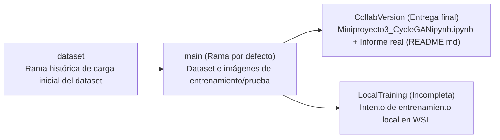

# Miniproyecto 3: Conversión de Escenas Diurnas a Nocturnas con CycleGAN

[](https://colab.research.google.com/drive/1ncPuuHFTQE7GEdXsXIblcEQ_qjBBSk1i?usp=sharing)

**Curso:** Redes Neuronales y Deep Learning — Universidad Autónoma de Occidente  
**Repositorio:** `https://github.com/AlanBas18/RepositorioMiniproyecto3`  
**Google Colab:** https://colab.research.google.com/drive/1ncPuuHFTQE7GEdXsXIblcEQ_qjBBSk1i?usp=sharing

Proyecto de traducción bidireccional de imágenes no emparejadas (*unpaired image-to-image translation*) entre escenas urbanas de **Día (Dominio A)** y **Noche (Dominio B)** mediante una red **CycleGAN**.

---

## Nota Importante sobre la Entrega

* **Entrega oficial (Notebook + Informe real):** Se encuentra en la rama **[`CollabVersion`](../../tree/CollabVersion)**, la cual contiene el archivo ejecutable para Google Colab (`Miniproyecto3_CycleGANipynb.ipynb`) y el **informe técnico completo** (`README.md` de esa rama).
* **Propósito de la rama `main`:** Esta rama se utiliza como fuente de datos para **descargar las imágenes de entrenamiento, evaluación y prueba final** automáticamente al clonar el repositorio desde Google Colab.

---

## Estructura de Git y Ramas del Repositorio



| Rama | Estado | Contenido principal | Descripción |
| :--- | :--- | :--- | :--- |
| **`CollabVersion`** | Completa (Entrega) | `Miniproyecto3_CycleGANipynb.ipynb`, `README.md` | **Rama de entrega oficial.** Contiene el notebook listo para ejecutarse en Google Colab (GPU T4) y el informe técnico real del proyecto (arquitectura, funciones de pérdida, métricas y pipeline). |
| **`main`** | Activa (Datos) | `dataset/`, `prueba final/`, `README.md` | **Rama principal de datos.** Aloja las imágenes de entrenamiento, prueba y presentación final que el notebook de Colab descarga mediante `git clone`. |
| **`LocalTraining`** | Incompleta | `Miniproyecto3_CycleGANipynb.ipynb`, `requirements.txt`, `dataset/`, `prueba final/` | Intento de adaptación para entrenamiento local. **No está completa** porque la compatibilidad de aceleración gráfica (GPU) en **WSL** es muy mala, lo que impidió completar el entrenamiento de forma estable en entorno local. |
| **`dataset`** | Histórica | `.gitattributes`, `dataset/` | Rama auxiliar utilizada durante la carga inicial del conjunto de imágenes. |

---

## Estructura de Archivos en `main`

```text
RepositorioMiniproyecto3/
├── dataset/
│   ├── trainA/          # Imágenes de entrenamiento - Día (204 archivos)
│   ├── trainB/          # Imágenes de entrenamiento - Noche (201 archivos)
│   ├── testA/           # Imágenes de evaluación - Día (20 archivos)
│   └── testB/           # Imágenes de evaluación - Noche (20 archivos)
├── prueba final/
│   ├── dia/             # Fotografías propias de día (2 archivos)
│   └── noche/           # Fotografías propias de noche (2 archivos)
└── README.md
```

---

## Cómo Consultar la Entrega y Ejecutar el Proyecto

1. Cambia a la rama **`CollabVersion`** para revisar el **informe técnico completo** y descargar `Miniproyecto3_CycleGANipynb.ipynb`.
2. Abre `Miniproyecto3_CycleGANipynb.ipynb` en **Google Colab** con aceleración por GPU (**T4 GPU**).
3. Ejecuta las celdas en orden: el notebook clonará automáticamente la rama `main` de este repositorio para descargar las imágenes de `dataset/` y `prueba final/`.
