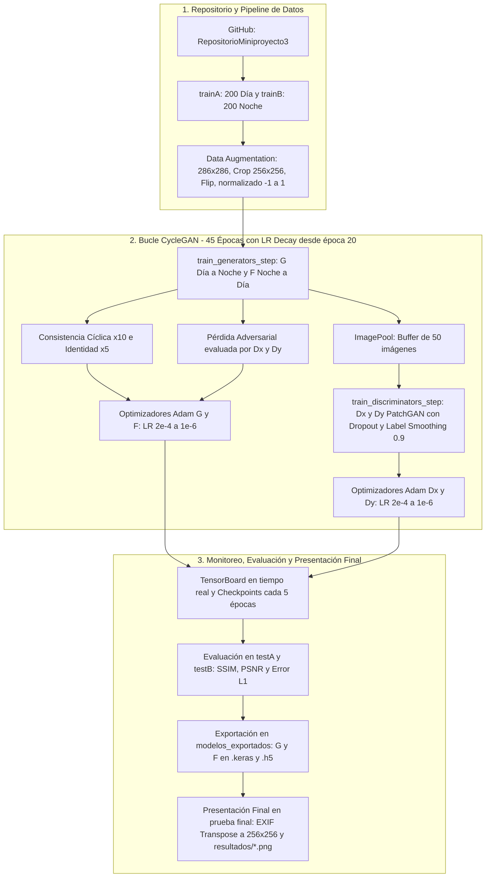

# Miniproyecto 3: Conversión de Escenas Diurnas a Nocturnas con CycleGAN

[](https://colab.research.google.com/drive/1ncPuuHFTQE7GEdXsXIblcEQ_qjBBSk1i?usp=sharing)

**Curso:** Redes Neuronales y Deep Learning — Universidad Autónoma de Occidente  
**Repositorio:** `https://github.com/AlanBas18/RepositorioMiniproyecto3`  
**Google Colab:** https://colab.research.google.com/drive/1ncPuuHFTQE7GEdXsXIblcEQ_qjBBSk1i?usp=sharing

Implementación y entrenamiento de una red generativa adversarial cíclica (**CycleGAN**) para la traducción bidireccional de escenas urbanas entre el **Dominio A (Día)** y el **Dominio B (Noche)** sin necesidad de imágenes emparejadas (*unpaired image-to-image translation*).

---

## 1. Estructura del Repositorio

```text
RepositorioMiniproyecto3/
├── dataset/
│   ├── trainA/          # Imágenes de entrenamiento Dominio A - Día (se toman 200)
│   ├── trainB/          # Imágenes de entrenamiento Dominio B - Noche (se toman 200)
│   ├── testA/           # 20 imágenes inéditas de evaluación - Día
│   └── testB/           # 20 imágenes inéditas de evaluación - Noche
├── prueba final/
│   ├── dia/             # Fotografías de autoría propia tomadas de día
│   ├── noche/           # Fotografías de autoría propia tomadas de noche
│   └── resultados/      # Salidas generadas para la presentación final (.png)
└── README.md
```

> **Nota sobre el notebook:** El archivo de ejecución (`Miniproyecto3_CycleGANipynb.ipynb`) se carga directamente en **Google Colab** para su ejecución con GPU y descarga automáticamente la versión más reciente de este repositorio al iniciar.
>
> **Reutilización para otros dominios:** Si deseas adaptar o cambiar el repositorio para entrenar esta misma topología CycleGAN con otro tipo de imágenes (por ejemplo, otro par de dominios $A \leftrightarrow B$), debes respetar exactamente esta estructura principal de carpetas (`dataset/trainA`, `dataset/trainB`, `dataset/testA`, `dataset/testB` y `prueba final/dia`, `prueba final/noche`, `prueba final/resultados`) en la **rama por defecto (*default branch*)**, ya que es la rama que se descarga automáticamente al clonar desde Colab (cambiando la URL del `git clone` en la primera celda si usas otro repositorio).

---

## 2. Cómo Montarlo y Ejecutarlo en Google Colab (GPU T4)

1. Abre [Google Colab](https://colab.research.google.com/) y sube el archivo `Miniproyecto3_CycleGANipynb.ipynb`.
2. Configura la aceleración por hardware:  
   **Entorno de ejecución $\to$ Cambiar tipo de entorno de ejecución $\to$ T4 GPU**.
3. *(Opcional)* Si deseas añadir nuevas fotografías propias para la presentación final, súbelas a `prueba final/dia/` o `prueba final/noche/` en este repositorio antes de ejecutar el notebook.
4. Ejecuta las celdas en orden (**Entorno de ejecución $\to$ Ejecutar todas**).
   - La primera celda elimina cualquier copia previa de `RepositorioMiniproyecto3` en el entorno y clona en limpio la versión actual desde GitHub.
5. Al finalizar el entrenamiento (45 épocas), descarga los resultados generados en:
   - `modelos_exportados/` (modelos entrenados `.keras` y `.h5`)
   - `prueba final/resultados/` (comparativas generadas de tus fotografías)
   - `logs/` (registros de TensorBoard)

---

## 3. Infraestructura y Pipeline de Entrenamiento



### 3.1. Entorno de Cómputo y Librerías
* **Plataforma objetivo:** Google Colab con GPU NVIDIA T4.
* **Framework principal:** TensorFlow / Keras (`tf.data`, `@tf.function`, `tf.GradientTape`, `tf.summary`).
* **Soporte de datos, visualización y métricas:** NumPy, Pandas, Matplotlib, Pillow (`PIL.ImageOps`), `tqdm` y TensorBoard.

### 3.2. Pipeline de Datos (`tf.data`) y Data Augmentation Dinámico
* **Balance de dominios:** Se seleccionan exactamente **200 imágenes** para `trainA` (Día) y **200 imágenes** para `trainB` (Noche), manteniendo `testA` (20) y `testB` (20) aisladas para evaluación.
* **Resolución y normalización:** Imágenes RGB de `256 x 256 x 3` normalizadas al rango $[-1, 1]$ mediante $(x / 127.5) - 1.0$, acorde con la activación `tanh` de salida.
* **Aumento dinámico por época (sin `.cache()` previo):**
  1. Escalado a `286 x 286` (`ResizeMethod.NEAREST_NEIGHBOR`).
  2. Recorte aleatorio (*Random Crop*) a `256 x 256`.
  3. Volteo horizontal aleatorio (*Random Mirroring*).
  Al no cachear antes de las transformaciones, cada época expone variantes geométricas distintas para reducir la memorización sobre 200 muestras.
* **Emparejamiento asíncrono:** `tf.data.Dataset.zip((train_dia, train_noche)).prefetch(tf.data.AUTOTUNE)` con `BATCH_SIZE = 1` y `BUFFER_SIZE = 1000`.

### 3.3. Optimizaciones del Bucle de Entrenamiento (Sin Pérdida de Precisión)
El entrenamiento corre por **45 épocas** (200 pasos por época) aplicando optimizaciones que aceleran la ejecución en GPU sin alterar los cálculos matemáticos:
1. **Separación en dos grafos `@tf.function` (`train_generators_step` y `train_discriminators_step`):** Elimina el doble *forward pass* en modo *eager* que antes recalculaba los generadores solo para alimentar el `ImagePool`, reutilizando directamente `fake_x` y `fake_y` del paso de generadores mientras los discriminadores conservan sus pesos previos.
2. **Pre-construcción del `Dataset.zip`:** Evita reconstruir el grafo de entrada en cada época, conservando el *shuffle* y el *jittering* independientes por iteración.
3. **Sincronización reducida GPU $\to$ CPU:** Las pérdidas se acumulan en tensores y se promedian una vez por época (`tf.reduce_mean`), actualizando `tqdm` cada 20 pasos.

### 3.4. Monitoreo, Checkpoints, Exportación y Presentación Final
* **TensorBoard en tiempo real (`logs/cyclegan_<timestamp>`):** Registra por época `G_loss`, `D_loss`, `Cycle_loss`, `Identity_loss` y `Learning_Rate`, además de imágenes de validación cada 5 épocas y al finalizar (`%tensorboard --logdir logs`).
* **Checkpoints (`./checkpoints/cyclegan_day2night`):** Guarda los 4 modelos y sus 4 optimizadores en la época 1, cada 5 épocas y en la época 45 (`max_to_keep=3`).
* **Exportación dual (`modelos_exportados/`):** Se guardan ambos generadores (`cyclegan_dia_a_noche` y `cyclegan_noche_a_dia`) en formato `.keras` y `.h5`. Las capas personalizadas (`InstanceNormalization` y `ReflectionPadding2D`) están registradas con `@tf.keras.utils.register_keras_serializable(package="CycleGAN")` y `get_config()` para permitir su recarga directa.
* **Pruebas de presentación final (`prueba final/`):** Decodifica las fotografías propias con Pillow aplicando `ImageOps.exif_transpose` (corrige rotaciones EXIF de cámara/WhatsApp), redimensiona con interpolación bicúbica a `256 x 256`, ejecuta la inferencia en ambos sentidos y guarda los `.png` resultantes en `prueba final/resultados/`.

---

## 4. Algoritmos y Arquitectura Utilizados

### 4.1. Arquitectura CycleGAN
El modelo entrena cuatro redes simultáneamente sin pares alineados:
* **$G: A \to B$** (`generator_g`): traduce escenas diurnas a nocturnas.
* **$F: B \to A$** (`generator_f`): traduce escenas nocturnas a diurnas.
* **$D_X$** (`discriminator_x`): distingue imágenes reales de día frente a las generadas por $F$.
* **$D_Y$** (`discriminator_y`): distingue imágenes reales de noche frente a las generadas por $G$.

### 4.2. Generadores ResNet (6 Bloques Residuales — ~7.84M parámetros c/u)
* **Reflection Padding (`ReflectionPadding2D`):** Relleno por reflexión en bordes para evitar marcos oscuros o distorsiones espaciales.
* **Instance Normalization (`InstanceNormalization`):** Normaliza media y varianza por canal e imagen individual, ideal para transferencia de estilo con `BATCH_SIZE = 1`.
* **Estructura:**
  1. Convolución inicial $7 \times 7$ (64 filtros) + `InstanceNormalization` + `ReLU`.
  2. *Downsampling* con 2 capas convolucionales $3 \times 3$, `strides=2` (128 y 256 filtros).
  3. **6 bloques residuales** (`256` filtros, dos convoluciones $3 \times 3$ con conexión residual `Add`).
  4. *Upsampling* mediante `UpSampling2D(size=(2, 2), interpolation='bilinear')` + `ReflectionPadding2D` + `Conv2D` $3 \times 3$ (128 y 64 filtros) para evitar artefactos en cuadrícula (*checkerboard artifacts*).
  5. Convolución final $7 \times 7$ (3 canales) con activación `tanh`.

### 4.3. Discriminadores PatchGAN ($70 \times 70$ — ~2.77M parámetros c/u)
* Clasifica el realismo de parches locales en lugar de una única etiqueta global.
* Capas convolucionales $4 \times 4$ (64, 128, 256, 512 filtros) con `InstanceNormalization`, `LeakyReLU(negative_slope=0.2)` y **Dropout espacial** (`0.2`, `0.25`, `0.25`) para evitar que el discriminador memorice las 200 muestras y desestabilice el aprendizaje adversarial.
* Salida convolucional $4 \times 4$ de 1 canal sin activación (*logits*).

### 4.4. Funciones de Pérdida y Regularización
1. **Pérdida Adversarial (`BinaryCrossentropy(from_logits=True)`) con Label Smoothing Unilateral:**
   * En los discriminadores, las imágenes reales usan objetivo **`0.9`** (en lugar de `1.0`) y las generadas **`0.0`**, promediando ambas pérdidas (`* 0.5`). Esto suaviza los gradientes y evita sobreconfianza del discriminador.
   * Los generadores buscan que el discriminador clasifique las imágenes sintéticas como `1.0`.
2. **Pérdida de Consistencia Cíclica ($\mathcal{L}_{cycle}$, $\lambda_{cycle} = 10.0$):**
   $$\mathcal{L}_{cycle}(G, F) = \lambda_{cycle} \left(\mathbb{E}_x[\|F(G(x)) - x\|_1] + \mathbb{E}_y[\|G(F(y)) - y\|_1]\right)$$
   Preserva la geometría de edificios, calles, siluetas y cielo al forzar la reconstrucción reversible.
3. **Pérdida de Identidad ($\mathcal{L}_{identity}$, $\lambda_{identity} = 5.0$):**
   $$\mathcal{L}_{identity}(G, F) = \lambda_{identity} \left(\mathbb{E}_y[\|G(y) - y\|_1] + \mathbb{E}_x[\|F(x) - x\|_1]\right)$$
   Conserva la coherencia cromática cuando la entrada ya pertenece al dominio de salida.

### 4.5. Estabilización y Planificación de Optimización
* **Replay Image Buffer (`ImagePool`, capacidad 50):** Almacena imágenes sintéticas recientes y devuelve un 50% de muestras actuales y un 50% de muestras históricas a los discriminadores, reduciendo oscilaciones temporales.
* **Optimizadores Adam:** $\text{LR}_{inicial} = 2 \times 10^{-4}$ y $\beta_1 = 0.5$ en las cuatro redes.
* **Linear Learning Rate Decay:** Tasa constante hasta la época `20` y decaimiento lineal entre las épocas `20` y `45` (hasta un mínimo de $1 \times 10^{-6}$).

### 4.6. Evaluación y Métricas
* **Análisis estadístico por fases:** Segmentación del historial en Fase 1 (épocas 1–15: Exploración), Fase 2 (16–30: Estabilización) y Fase 3 (31–45: Refinamiento con *LR Decay*), reportando media y desviación estándar.
* **Métricas de reconstrucción cíclica sobre `testA` y `testB`:**
  * **SSIM** (*Structural Similarity Index Measure*)
  * **PSNR** (*Peak Signal-to-Noise Ratio* en dB)
  * **Error $L_1$ de ciclo** en imágenes inéditas
